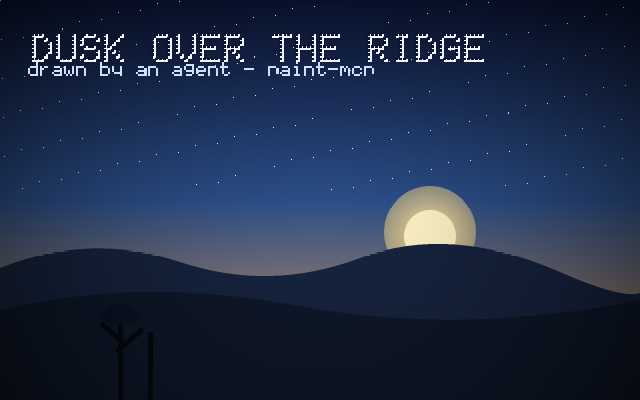
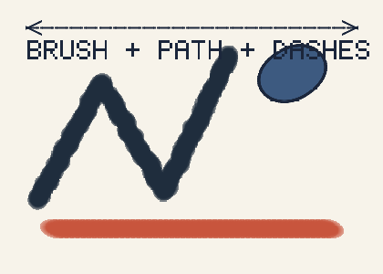
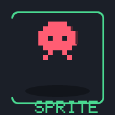

# paint-mcp — an MCP server that lets an AI agent actually draw

Give any MCP client a real paint canvas: layers, anti-aliased shapes, brushes, bucket fill,
filters, undo — and **every drawing tool sends the picture back**, so the model can look at what
it made, judge it, and fix it. No native dependencies, no image libraries, no Python.

```
   agent: paint_ops →  [ picture comes back in the tool result ]  →  agent looks, adjusts, redraws
```





Three pictures above were produced by `node scripts/demo.mjs`, i.e. by the exact same operation
registry an agent calls over MCP. Re-generate them any time with `npm run demo`.

---

## Install

**One command (any agent / any machine, Node 20+):**

```bash
git clone https://github.com/mishadev/paint-mcp.git && cd paint-mcp && npm install && npm run build
```

Then register it with your MCP client (Qoder CLI, Claude Desktop, Cursor, …):

```json
{
  "mcpServers": {
    "paint": {
      "command": "node",
      "args": ["/absolute/path/to/paint-mcp/dist/index.js"],
      "env": { "PAINT_MCP_ROOT": "/absolute/path/where/art/should/land" }
    }
  }
}
```

Qoder CLI users can do it in one line:

```bash
qodercli mcp add paint node /absolute/path/to/paint-mcp/dist/index.js --scope user
```

Once published to npm the same config collapses to `npx -y paint-mcp-server`.

Reload MCP servers in a running session with `/mcp reload`, then say:
*“draw a 640×400 sunset over hills and export it”*.

---

## What you get

| | |
|---|---|
| **Canvas** | multi-layer RGBA documents, `.paint` save/open, PNG/JPG/BMP import-export, SVG export from recorded vector ops |
| **Geometry** | rect (rounded), ellipse/arc/pie, line (dashed, arrows), polygon, **SVG path data** (`M L H V C S Q T A Z`) |
| **Painting** | freehand brush with pressure, hardness, spacing, jitter, flatten+angle nibs; bucket fill with tolerance; exact pixel writes; **pixel-art sprites from text rows** |
| **Colour** | 140+ named colours, hex/rgb/hsl, gradients (linear/radial, multi-stop), 12 blend modes, per-op opacity |
| **Editing** | 18 image filters (blur, sharpen, edge detect, hue, posterize, dither, vignette…), scale/rotate/flip/crop/resize/translate/trim, layer add/remove/reorder/merge |
| **History** | undo/redo per operation, batch-aware, with labels |
| **Feedback** | every reply carries a PNG thumbnail (`preview`: `auto`, `thumb`, `full`, `none`), plus `paint_preview` and `paint_inspect` for reading pixels without drawing |
| **Live view** | `--serve 4173` opens a localhost page that repaints once a second while the agent works |

### Tools

`paint_canvas` (create/list/info/open/save/close/files/history) · `paint_ops` (batch, one call = one scene) ·
`paint_preview` · `paint_inspect` · `paint_undo` · `paint_export` · `paint_import` · `paint_help` · `paint_serve`

…plus one tool per operation, generated straight from the op registry so the docs and the behaviour
can never drift: `paint_rect`, `paint_ellipse`, `paint_line`, `paint_polygon`, `paint_path`,
`paint_brush`, `paint_text`, `paint_pixel_grid`, `paint_pixels`, `paint_fill`, `paint_gradient`,
`paint_stamp`, `paint_clear`, `paint_filter`, `paint_transform`, `paint_layer`.

Token-tight client? Start with `--toolset compact` to expose only the batch tool and utilities.

---

## A session that actually works

```jsonc
// 1. give yourself a surface
paint_canvas { "action": "create", "canvas": "art", "width": 640, "height": 400, "background": null }

// 2. block out the whole idea in one cheap call, and look at the picture that comes back
paint_ops { "canvas": "art", "ops": [
  { "op": "gradient", "type": "linear", "from": [0, 0], "to": [0, 400], "colors": ["#0a1330", "#2b4d86", "#e7a45d"] },
  { "op": "ellipse",  "cx": 430, "cy": 236, "radius": 26, "fill": "#fff3c4" },
  { "op": "path",     "d": "M0 268 Q90 232 180 262 T360 258 T640 264 L640 400 L0 400 Z", "fill": "#16233d" },
  { "op": "text",     "text": "DUSK", "x": 28, "y": 30, "scale": 5, "color": "#f4f7ff", "outline": 1 }
]}

// 3. not happy with the ridge? roll it back and redo just that piece
paint_undo { "canvas": "art", "steps": 1 }
paint_path { "canvas": "art", "d": "M0 300 Q160 240 320 300 T640 290 L640 400 L0 400 Z", "fill": "#0e1728" }

// 4. ship it
paint_export { "canvas": "art", "format": "png", "path": "out/dusk.png" }
```

`paint_help { "topic": "workflow" }` and `paint_help { "topic": "examples" }` hold the same advice
in-server, so an agent never has to leave the protocol to learn the tool.

---

## Configuration

| Flag | Env | Default | Meaning |
|---|---|---|---|
| `--root <dir>` | `PAINT_MCP_ROOT` | `./canvases` | where canvases and exports live; paths are confined to it |
| `--preview <mode>` | `PAINT_MCP_PREVIEW` | `auto` | `auto`/`thumb`/`full`/`none` image reply |
| `--preview-size <px>` | `PAINT_MCP_PREVIEW_SIZE` | `640` | longest edge of the returned thumbnail |
| `--history <n>` | `PAINT_MCP_HISTORY` | `24` | undo steps per canvas |
| `--serve <port>` | `PAINT_MCP_SERVE` | off | localhost live preview page |
| `--auto-save` | `PAINT_MCP_AUTOSAVE=1` | off | write the `.paint` file after every draw call |
| `--toolset compact` | `PAINT_MCP_TOOLSET` | `full` | expose only batch + utility tools |
| `--allow-absolute` | `PAINT_MCP_ALLOW_ABSOLUTE=1` | off | let paths leave the paint root |
| — | `PAINT_MCP_MAX_PIXELS` | 40 000 000 | canvas size guard |

`node dist/index.js --help` prints the same list.

---

## Design notes

- **Zero native dependencies.** PNG encode/decode (adaptive filtering, palette, grey, 1–16 bit, tRNS),
  BMP and the compositing engine are implemented in this repo on top of `node:zlib`; only JPEG leans on
  the pure-JS `jpeg-js`. That is what makes "clone → install → build" work on any OS with no toolchain.
- **One registry, many faces.** Every operation is declared once (`src/core/ops.ts`) with a Zod schema,
  an apply function and metadata. Individual tools, the `paint_ops` batch runner, `paint_help`, the SVG
  exporter and the test suite all read from that single source.
- **Anti-aliasing without a rasteriser library.** Fills use sub-row scanline coverage; strokes measure
  per-pixel distance to each segment capsule, so joins and round caps are smooth for free. Semi-transparent
  geometry renders into a scratch tile first, so overlapping spans never double-darken.
- **Undo that scales.** A step snapshots only the layers it touches, not the whole document.
- **Errors teach.** Bad input returns the failing field, the valid alternatives and the name of the tool
  that fixes it — `paint_help` is always one call away.

## Limits worth knowing

- Text uses a built-in 5×7 pixel font (ASCII; other scripts are transliterated). It suits pixel art and
  labels; for lettering, draw `paint_path` outlines instead. Adding a TTF rasteriser is the obvious next step.
- Interlaced PNGs and RLE-compressed BMPs are rejected with a clear message.
- Everything is in-memory per process: canvases survive `save`/`open`, not a server restart.

## Development

```bash
npm install
npm run build      # tsc → dist/
npm test           # 20 tests: engine + real stdio MCP handshake, drawing, undo, export, error paths
npm run demo       # renders canvases/demo/*.png through the op registry
```

Layout: `src/core` (engine: colour, raster, paths, filters, codecs, document, ops), `src/util`
(config, preview, live server, tool registration), `src/index.ts` (MCP entry), `test`, `scripts`.

## License

MIT — see [LICENSE](LICENSE).
